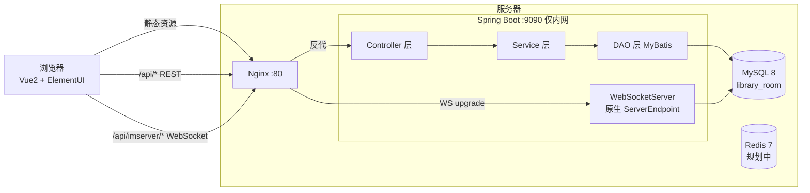
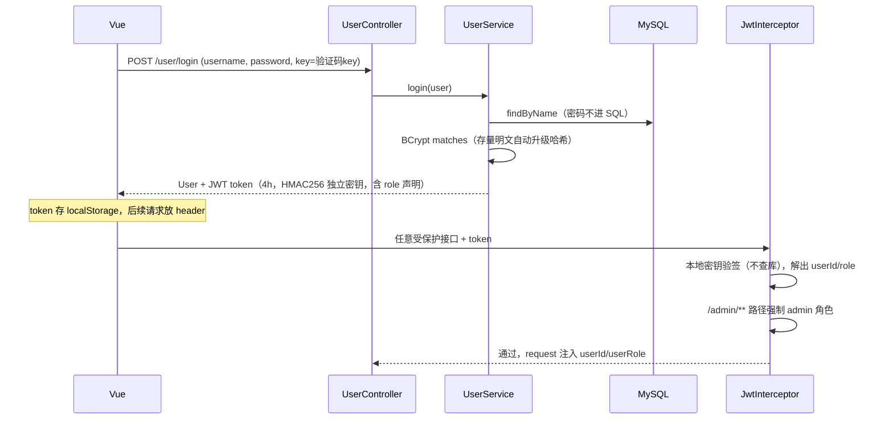
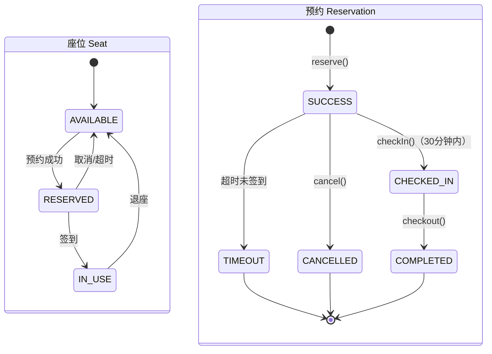
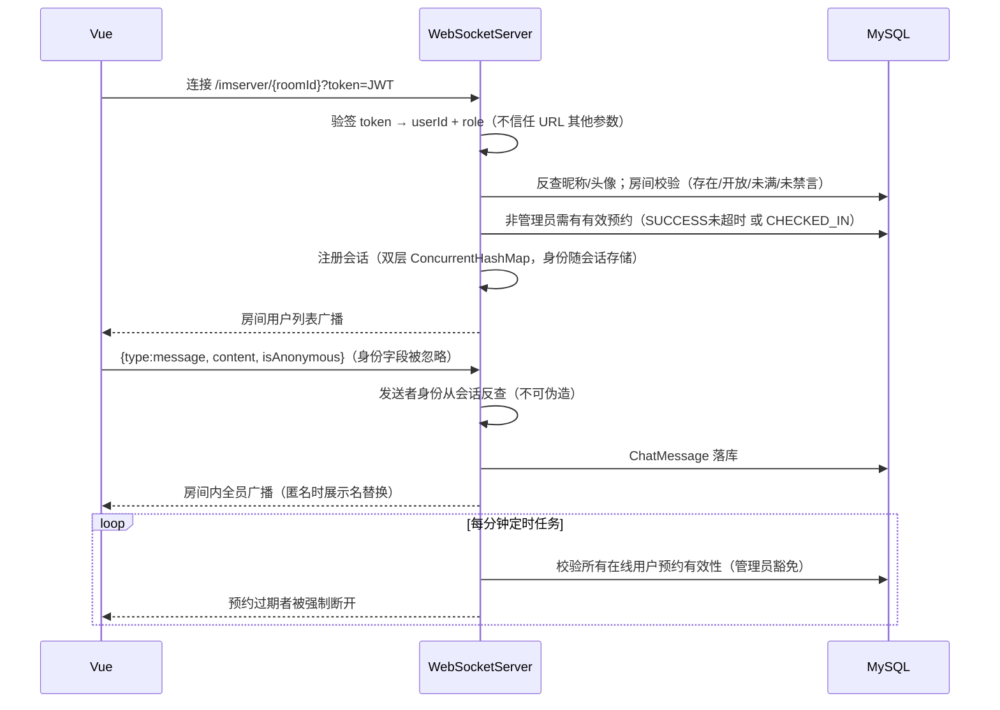
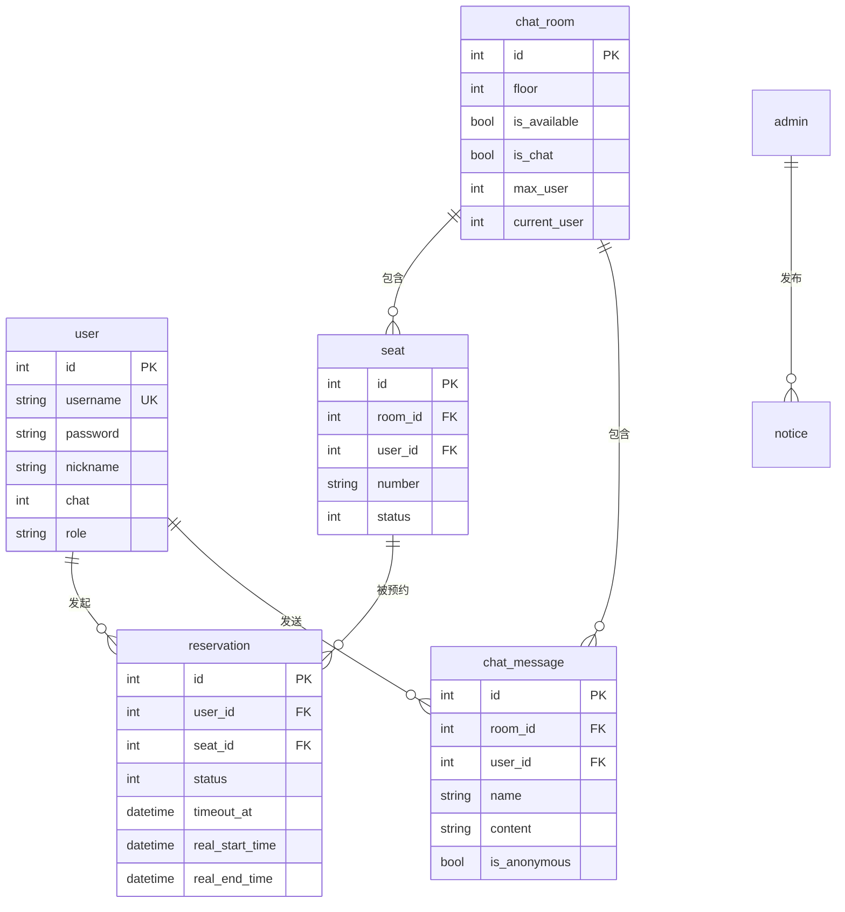

# 系统架构说明

> 阅览室管理系统：基于 Spring Boot + Vue 的图书馆座位预约与楼层聊天室系统。
> 核心特色是「物理身份 - 虚拟权限」联动：座位预约状态与聊天室访问权限动态绑定。

## 1. 总体架构

前后端分离 + 单体分层架构，生产环境经 Nginx 同源反向代理：



**请求入口两类**：
- REST 请求：`Nginx /api/*` → 剥掉前缀 → `127.0.0.1:9090`（后端不暴露公网）
- WebSocket：`/api/imserver/{roomId}/{userId}/{avatar}` → Nginx 做 HTTP Upgrade → 后端原生 WebSocket 端点

## 2. 后端分层

```
com.example
├── controller/     接口层：9 个 Controller，参数接收 + 调 Service + 统一 Result 返回
├── service/        业务层：预约状态机、超时释放定时任务、聊天室管理
│   └── impl/
├── dao/            数据访问层：MyBatis XML（手写 SQL）+ tk.mybatis（通用 Mapper）混用
├── entity/         实体 + 状态枚举（SeatStatus / ReservationStatus）
├── common/         横切组件
│   ├── JwtInterceptor / JwtTokenUtils     认证
│   ├── WebSocketServer / WebSocketConfig  实时通信
│   ├── RateLimiterInterceptor / Config    Guava 接口限流
│   ├── CorsConfig / WebConfig / CaptureConfig(验证码)
│   └── Result 统一返回体
└── exception/      CustomException + 全局异常处理器
```

横切链路（所有 REST 请求经过）：

```mermaid
flowchart LR
    REQ[请求] --> CORS[CorsFilter] --> RATE[RateLimiter 拦截器<br/>全局限流] --> JWT[JwtInterceptor<br/>按路径拦截] --> CTRL[Controller] --> SVC[Service<br/>@Transactional] --> DAO[DAO] --> DB[(MySQL)]
    CTRL --> EXC[GlobalExceptionHandler] --> RES[统一 Result]
```

JWT 拦截器按路径生效（`WebConfig`）：拦截 `/user/**`、`/admin/**`、`reservations/**`、`/seats/**`、`chatroom/**`；放行登录、注册、验证码、`/files/**` 与 `/imserver/**`（WebSocket 自行校验）。

## 3. 核心调用链

### 3.1 认证链（登录 → 鉴权）



双角色设计：角色写入 token 声明（user/admin），拦截器据此放行；`/admin/**` 路径拒绝 user token。`JWT_SECRET` 经环境变量注入，未配置则启动失败（fail-fast）。库中存量明文密码由启动迁移器（`PasswordMigrationRunner`）自动哈希化。

### 3.2 座位预约链（状态机）

座位与预约双状态机，所有状态迁移集中在 `ReservationServiceImpl`：



超时回收双保险：① 用户触发任意预约查询时 `validateReservation(autoUpdate=true)` 惰性回收；② `@Scheduled(fixedRate=60000)` 定时扫描超时记录统一释放并广播。

> ⚠️ 已知问题：`reserve()` 为 check-then-act 模式（先查状态后插入，无锁），并发下同一座位可被重复预约——改造方案：数据库唯一索引 + 乐观锁 / Redis 分布式锁。

### 3.3 聊天室链（WebSocket 生命周期）



多房间状态管理：`Map<roomId, Map<sessionId, Session>>` 双层结构，房间之间完全隔离；前端配套心跳保活（30s）与指数性断线重连（最多 5 次）。

## 4. 数据模型（7 表）



索引：`reservation(user_id)`、`reservation(seat_id)`、`chat_message(room_id/user_id/time)`、`user/admin(username 唯一)`。

## 5. 前端架构

```
vue/src
├── views/          页面：user/（Home、SeatReservation、Profile…）
│                   admin/（Dashboard、UserManagement、SeatManagement…）
│                   chat/（ChatRoomList、ChatRoom、ChatRoomAdmin）
├── store/modules/  Vuex：chat（消息/在线列表）、seat（座位状态缓存）
├── utils/          request.js（axios 封装：token 注入、角色头、统一错误提示）
│                   websocket.js（WS 封装：心跳、重连、消息分发）
└── router/         路由守卫：未登录重定向
```

## 6. 部署架构（当前生产）

| 组件 | 方式 | 说明 |
| --- | --- | --- |
| Nginx | 系统服务 :80 | 静态托管 `vue/dist` + `/api/*` 反代（含 WS Upgrade）+ gzip |
| Spring Boot | systemd `reading-room` | 仅监听 `127.0.0.1:9090`，崩溃自动重启 |
| MySQL | 系统服务 | 专用账号 `readingroom`，密码走 `/etc/reading-room.env`（600） |
| 配置 | 环境变量注入 | `DB_*`、`SERVER_ADDRESS`，仓库无任何密钥/内网信息 |
| 前端 | vue-cli 构建 | API 走同源 `/api`；WS 地址运行时按页面域名推导 |

## 7. 已知技术债

见 [README · 已知问题与 Roadmap](../README.md#已知问题与-roadmap)：密码明文、JWT 密钥设计、WebSocket 鉴权、预约并发竞态、双 WebSocket 体系冗余（STOMP 配置为未使用的死代码）、参数校验缺失、无自动化测试。以上均为下一阶段迭代内容。
